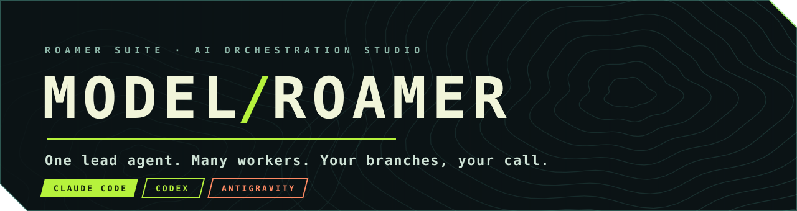

<div align="center">



<br>

[](https://github.com/Tox-EyE-CeaZY/Model-Roamer/releases/latest)
[](https://github.com/Tox-EyE-CeaZY/Model-Roamer/releases)

[](LICENSE)

**[Get it](#-get-it)** · **[What it does](#-what-it-does)** · **[Use it from other devices](#-use-it-from-other-devices)** · **[Work with other people](#-work-with-other-people)** · **[Heads-up for older versions](#%EF%B8%8F-heads-up-older-versions-and-disk-space)** · **[Build it](#-build-it)**

</div>

<br>

**Model Roamer** is an AI orchestration studio and the third app in the Roamer suite, next to
[Board Roamer](https://github.com/Tox-EyE-CeaZY/Board-Roamer) and [Web Roamer](https://github.com/Tox-EyE-CeaZY/Web-Roamer),
with the same look: chamfered ticket-stub panels, a contour-map background and the **MODEL/ROAMER** title bar.

One **lead** agent plans the work and starts **worker threads** in **Claude Code**, **Codex** and **Antigravity**, all at the
same time. Every worker gets its own git branch and its own folder, so they never edit the same files. You watch, answer
the questions they raise, and merge what you like.

It runs on **your own subscriptions** through each agent's command-line tool. There is no Model Roamer account and no
server in the middle.

<br>

## ⬇️ Get it

Grab the file for your device from the **[latest release](https://github.com/Tox-EyE-CeaZY/Model-Roamer/releases/latest)**:

| System | File |
| --- | --- |
| 🪟 Windows 10/11 (most laptops) | `model-roamer-windows-x64.exe` |
| 🪟 Windows on ARM | `model-roamer-windows-arm64.exe` |
| 🍎 macOS (Apple silicon / Intel) | `ModelRoamer-macos-arm64.zip` / `ModelRoamer-macos-x64.zip` |
| 🐧 Linux desktop | `model-roamer-linux-x64` (needs `libwebkit2gtk-4.1`) |
| 🖥️ Linux server, no window (x64 / ARM, e.g. a Raspberry Pi) | `model-roamer-server-linux-x64` / `model-roamer-server-linux-arm64` |
| 🤖 Android | `ModelRoamer-android.apk` |

Each desktop file is a single download with nothing to install. `SHA256SUMS.txt` on the release lets you check it.

> [!NOTE]
> **Windows:** the exe isn't code-signed, so SmartScreen may warn the first time you run it. Choose **More info → Run anyway**.
> It uses the Edge WebView2 runtime that comes with Windows 10 and 11.
>
> **Android:** the APK is installed by hand rather than from a store. Android will ask you to allow installs from your
> browser or file manager the first time. Later releases update over the top of earlier ones.

### First launch

A short walkthrough gets you going, and you never need a terminal:

1. **Get the agents ready.** Agents › **Install** fetches a command-line agent for you, and **Sign in** runs its login in a
   window inside the app. You need at least one of Claude Code, Codex or Antigravity.
2. **Connect GitHub** so Model Roamer can clone repositories, list pull requests and merge them.
3. **Make a project** (a folder or a GitHub repository), tell the lead what you want, and watch it open threads.

<br>

## ✨ What it does

<table>
<tr>
<td width="50%" valign="top">

### 🧭 A lead and its workers
Each project has a **lead** (Claude by default; Codex and Antigravity can lead too). It starts workers with the agent and
model that fit the job. Each worker has its own **git worktree and branch** and **claims the files** it is changing, so
two workers never touch the same thing.

</td>
<td width="50%" valign="top">

### 🗂️ A board that shows who needs you
Threads sit in lanes: **Needs you**, **Working**, **Paused** and **Done**. When an agent needs a decision it asks with a
card of options, and your answer wakes it up again.

</td>
</tr>
<tr>
<td valign="top">

### 🔀 Review and merge
See a thread's changes as a diff, merge its branch, or open a pull request. The **Git** tab lists the project's pull
requests and merges them on GitHub. Model Roamer signs in to GitHub itself.

</td>
<td valign="top">

### 🧠 Routing and fallback
Send kinds of work (frontend, backend, tests, docs, research) to the agent you prefer, for everything or per project. When
an agent runs out of its plan's usage, its threads move to the next one in line, or wait for the reset if you turn
fallback off. Set the **thinking strength** per kind of task.

</td>
</tr>
<tr>
<td valign="top">

### 🤝 Buddies
Pair two agents, give each a role (say, designer and builder) and pick the pair anywhere you would pick one agent. They take
turns on one thread until they say it's done or run out of turns.

</td>
<td valign="top">

### 💻 A local model
Settings › Local model installs an on-device model through llama.cpp (a small model for CPU or for a modest graphics
card). It powers the **Local Operator**, which answers questions about your project and coordinates threads without using
any plan.

</td>
</tr>
<tr>
<td valign="top">

### 🪟 Threads like email
Open any thread in its own window (**Ctrl+Shift+O**), or make pop-out the default under Settings › Windows. Several main
windows work too. Park a thread to set it aside, and interrupt the lead whenever you want.

</td>
<td valign="top">

### 🧾 Memory and artifacts
Global and per-project **memory** that agents read and write: search it, edit it, restore it from the trash. **Artifacts**
(pages, images and files agents publish) land in a gallery and viewer, filed under the project they belong to.

</td>
</tr>
<tr>
<td valign="top">

### 📊 Usage at a glance
Turns and tokens per agent per day, failures, and when each one hit its limit. A status bar shows each plan's
5-hour and weekly usage.

</td>
<td valign="top">

### 🌐 In-app browser and files
Preview a dev server an agent started, even from a phone: pages on the machine running Model Roamer are routed to
whatever device you are using. A **Files** tab lets you look through a project's folder.

</td>
</tr>
</table>

Also in the box: plain **Chats** with any agent outside a project, **voice input** (with an offline fallback that downloads
on first use), per-agent **instruction guides** so any lead can run any mix of agents, undo for deletes, a command palette
(**Ctrl+K**), a shortcut for nearly everything (press **?**), themes and an accent colour, and **automatic updates** from
GitHub releases (Windows and Linux; on macOS it opens the release page).

### 🧹 Disk space (2.2.2 and newer)

Rust build folders (`target`) in the app's own worktrees and clones are cleared automatically when a thread is resolved or
deleted, after a day unused, or, longest unused first, when together they pass 20 GB. Change the limits or turn it off in
Settings › Git and GitHub. Your own project folders are never touched, and neither is anything a running thread, build or
program is using.

<br>

## 🌍 Use it from other devices

Run Model Roamer on one machine (a desktop, a home server, a cloud box) and use it from any other: a laptop, a phone's
browser, the Android app, or another copy of the desktop app.

**From the desktop app:** Settings › Remote access › **Share this computer**. It lists the addresses it answers on and shows
a pairing code and QR code.

**As a headless server:**

```
model-roamer server                      # listens on 0.0.0.0:4630 and prints a pairing code
model-roamer server --port 8080 --name studio
model-roamer pair                        # a fresh code from the running server
```

On the other device, open `http://<server>:4630` in a browser (or **Connect** in the desktop app's server menu) and enter
the code. Desktop apps on the same network find servers on their own.

<details>
<summary><b>Ways to reach the server</b> (LAN, Tailscale, WireGuard, your own domain)</summary>

<br>

- **Same network (LAN):** use the address it shows, like `http://192.168.1.20:4630`, or the machine's name
  (`http://studio.local:4630`).
- **Tailscale:** install Tailscale on both devices and use the server's Tailscale name, like
  `http://studio.tailnet-name.ts.net:4630`. Nothing to open on your router. For HTTPS, run `tailscale cert` and pass the
  files with `--tls-cert` and `--tls-key`.
- **WireGuard:** connect the tunnel, then use the server's tunnel address, like `http://10.0.0.1:4630`.
- **Your own domain:** put it behind a reverse proxy that handles HTTPS (Caddy: `studio.example.com { reverse_proxy
  127.0.0.1:4630 }`), or serve HTTPS directly with `--tls-cert fullchain.pem --tls-key privkey.pem`. WebSockets must pass
  through (`/api/ws`).

Every device has to pair, codes expire and wrong guesses are rate-limited, and paired devices can be removed under
Settings › Remote access. If the server can be reached from the internet, use HTTPS.

</details>

<details>
<summary><b>Run it as a service on Linux</b> (systemd)</summary>

```ini
[Unit]
Description=Model Roamer
After=network-online.target

[Service]
ExecStart=/usr/local/bin/model-roamer-server-linux-x64 server
User=you
Restart=on-failure

[Install]
WantedBy=multi-user.target
```

</details>

<br>

## 👥 Work with other people

Share a project without any central service: **your** Model Roamer is the project's home, and each person you invite runs
their own copy with their own agent logins. Logins and keys never leave their machine.

- Settings › Collaborators › **Invite a person** makes a one-use link. They paste it under Settings › **Join a project**.
- Roles (**collaborator**, **operator**, **viewer**) set the defaults, and you can switch single permissions on or off per
  person.
- Everyone talks to their own lead in their own project chat, private unless you allow others to read it.
- Shared project memory, threads and artifacts stay in sync, and you see who is working on what, so two people don't open
  overlapping threads. Conflict notes are always a request the other person approves.

Collaborators' agents only ever run on their own accounts. Revoking someone takes effect on their next request. Details
are in [docs/collaboration.md](docs/collaboration.md).

<br>

## ⚠️ Heads-up: older versions and disk space

> [!WARNING]
> **Versions before 2.2.2 could quietly fill your disk.** Every worker thread builds in its own folder, and each Rust
> `cargo build` there leaves a `target` folder of several gigabytes that older versions never cleaned up. On one machine
> this reached about **80 GB**.
>
> **The fix:** update to **2.2.2 or newer**. A minute after it starts, Model Roamer clears these folders on its own (see
> [Disk space](#-disk-space-222-and-newer)).

**Already affected? Free the space safely.** Only the `target` folders are safe to delete. They are build output, and the
next build makes them again (just slower the first time).

1. Close Model Roamer, and make sure no agent is mid-build.
2. Delete the `target` folders inside the app's data folder. On Windows this works in PowerShell:

   ```powershell
   Remove-Item "$env:LOCALAPPDATA\ModelRoamer\worktrees\*\*\target" -Recurse -Force
   ```

   or look through `%LOCALAPPDATA%\ModelRoamer\worktrees\<project>\<thread>\` in File Explorer and delete each `target`.
   On macOS the folder is `~/Library/Application Support/ModelRoamer`, on Linux `~/.local/share/ModelRoamer`.
3. Start the app again.

> [!CAUTION]
> Delete only folders named `target`. **Don't delete the `worktrees` folder itself or the folders for each thread:** a
> thread that hasn't been merged keeps its unmerged work there. The database and your settings live in the same data
> folder too.

<br>

## 🛠️ Build it

Needs Rust (stable). On Linux also: `libwebkit2gtk-4.1-dev libgtk-3-dev libsoup-3.0-dev libxdo-dev
libayatana-appindicator3-dev libssl-dev`.

```
cargo run                                    # the desktop app
cargo run -- --browser                       # the app in your browser, at http://127.0.0.1:4625
cargo run -- server                          # the headless server
cargo build --release --no-default-features  # a server-only build, no window libraries needed
cargo test --no-default-features
```

<details>
<summary><b>Under the hood</b></summary>

<br>

- **Rust** with tokio and axum, one **SQLite** database (with full-text search) in your data folder, and the interface
  embedded in the binary. The desktop shell is tao + wry, behind the `desktop` feature.
- **The interface** is plain HTML, CSS and JavaScript modules in `ui/`, with no build step. Debug builds read it from disk,
  so a reload shows your changes. `tools/make_icon.py` draws the icon.
- **Agents** are driven through their own command-line tools. Each gets Model Roamer's tools over an MCP bridge
  (`model-roamer mcp`), and the guides in `prompts/` tell every agent how to work with the others.
- **Ports:** the app uses 4625 on your machine, the server 4630, and LAN discovery 4631. Set the data folder with
  `--data` or `MODEL_ROAMER_DATA`.
- **Data folder:** `%LOCALAPPDATA%\ModelRoamer` on Windows, `~/Library/Application Support/ModelRoamer` on macOS,
  `~/.local/share/ModelRoamer` on Linux.
- **Releases:** every push to `main` builds Windows, macOS, Linux and Android and publishes them as the release for the
  version in `Cargo.toml`. A `v*` tag publishes that version. Versions read `big.substantial.minor`.

</details>

<br>

<div align="center">

**MODEL/ROAMER** is part of the Roamer suite: [Board Roamer](https://github.com/Tox-EyE-CeaZY/Board-Roamer) ·
[Web Roamer](https://github.com/Tox-EyE-CeaZY/Web-Roamer) · Model Roamer

MIT licensed

</div>
